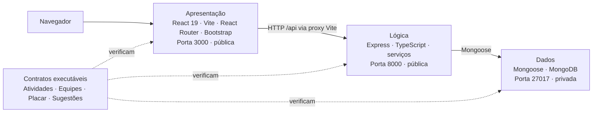

# Arquitetura do OctoFit Tracker

O OctoFit Tracker é uma aplicação de três camadas para um programa de atividades físicas escolar. O código inicial inclui contratos de API e pontos de implementação intencionalmente incompletos para que você use o modo agent do GitHub Copilot em um ciclo guiado por testes.

## Limites entre as camadas

- **Camada de apresentação**: React 19, Vite, React Router, Bootstrap e um cliente compartilhado da API em `octofit-tracker/frontend/src`.
- **Camada de lógica**: rotas e serviços Express com TypeScript em `octofit-tracker/backend/src` expõem o comportamento `/api/*` na porta `8000`.
- **Camada de dados**: modelos Mongoose e dados de demonstração em `octofit-tracker/backend/src/models` e `src/scripts/seed.ts` são persistidos no MongoDB na porta `27017`.

## Portas e regras de ambiente

- MongoDB: `27017` (privada)
- API Express: `8000` (pública)
- Interface Vite: `3000` (pública)
- O navegador acessa caminhos relativos `/api`. O Vite os encaminha para `http://localhost:8000`; `VITE_API_BASE_URL` pode substituir a URL-base.
- Não encaminhe nem torne públicas outras portas.

## Contrato da API

| Capacidade | Método e caminho | Comportamento esperado |
| --- | --- | --- |
| Registro de atividades | `GET /api/activities`, `POST /api/activities` | Lista e cria atividades válidas. POST recebe `userId`, `teamId`, `type` e `minutes`; `userId` e `teamId` devem ser IDs bem-formados de uma pessoa e uma equipe existentes, caso contrário a API retorna um 4xx intencional (nunca um 500 causado por erro de conversão). Uma atividade criada armazena `user`, `team`, `type` e `minutes` enviados, além de `points` e `occurredAt` calculados. |
| Equipes | `GET /api/teams`, `POST /api/teams` | Lista e cria equipes com integrantes. As equipes criadas e listadas mantêm os valores enviados em `name` e `mascot`. Rejeita uma equipe sem nome com `400`. |
| Placar | `GET /api/leaderboard` | Retorna as equipes ordenadas pela soma dos pontos de suas atividades, da maior para a menor. Cada item contém `teamName`, `totalPoints` e uma `rank` iniciada em 1. |
| Sugestões de treino | `GET /api/workouts/suggestions/:userEmail` | Recomenda treinos com base nos padrões de atividade recentes da pessoa correspondente ao e-mail seed. O foco da primeira sugestão (`focus`) corresponde à meta ou à atividade recente dessa pessoa, e o campo `reason` explica o motivo. Um e-mail sem pessoa correspondente retorna um 4xx intencional (por exemplo, `404`). |

## Decisões de implementação

- **Camada de apresentação:** substituir os componentes provisórios por telas que usem o cliente compartilhado em `frontend/src/api/client.ts` e apresentem dados, carregamento, estado vazio e erro em português, com anúncios acessíveis.
- **Camada de lógica:** manter as rotas como encaminhadoras e concentrar validações de entrada e regras de negócio nos serviços. Retornar 4xx intencionais para entradas inválidas, sem expor erros de conversão como 500.
- **Camada de dados:** completar os schemas Mongoose com os campos obrigatórios e tipos esperados pelos contratos. Manter `members` como lista vazia por padrão e preservar o seed idempotente, sem apagar coleções nem perder associações de equipes.
- **Registro de atividades:** validar IDs e existência das referências antes de criar a atividade; calcular pontos com base nos minutos e registrar a data de ocorrência no serviço.
- **Gerenciamento de equipes:** rejeitar equipes sem nome e manter nome, mascote e integrantes enviados tanto na criação quanto na listagem.
- **Placar:** somar os pontos das atividades por equipe, ordenar do maior total para o menor e numerar as posições a partir de 1.
- **Sugestões de treino:** localizar a pessoa pelo e-mail, considerar a meta e as atividades recentes para escolher o foco, explicar a recomendação em português e retornar 4xx quando a pessoa não existir.
- **Ordem de implementação:** modelos e persistência; serviços e contratos da API; integração e estados da interface. Executar os testes da camada alterada antes de avançar para a seguinte.

## Plano de testes

- **Dados:** `npm run test:data --prefix octofit-tracker/backend`. Verifica campos obrigatórios, referências, valores padrão e seed idempotente, incluindo a preservação de dados não relacionados. Linha de base: 4 falhas de validação de modelos; o teste de seed passou.
- **API:** `npm run test:api --prefix octofit-tracker/backend`. Verifica criação e listagem de atividades e equipes, rejeição de IDs malformados ou inexistentes sem 500, placar ordenado e sugestões baseadas na meta/atividade, incluindo e-mail desconhecido. Linha de base: 4 falhas nos contratos de atividades, equipes, placar e sugestões.
- **Frontend:** `npm test --prefix octofit-tracker/frontend`. Verifica dados exibidos, solicitação de sugestão para a pessoa esperada e estados acessíveis de carregamento, vazio e erro nas quatro rotas. Linha de base: 15 falhas, cobrindo esses comportamentos.
- **Compilação do backend:** `npm run build --prefix octofit-tracker/backend`, após implementar os serviços e antes de concluir a camada de lógica.
- **Compilação do frontend:** `npm run build --prefix octofit-tracker/frontend`, após integrar as telas e como verificação final.
